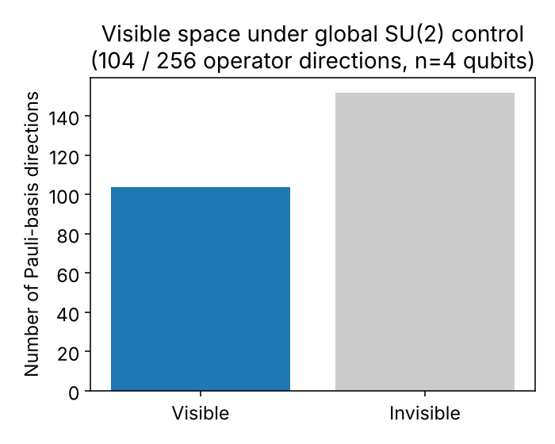
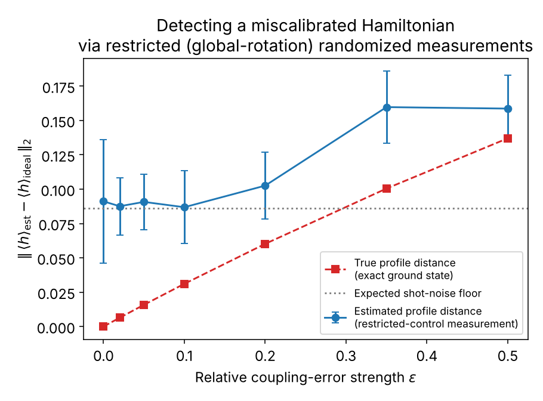
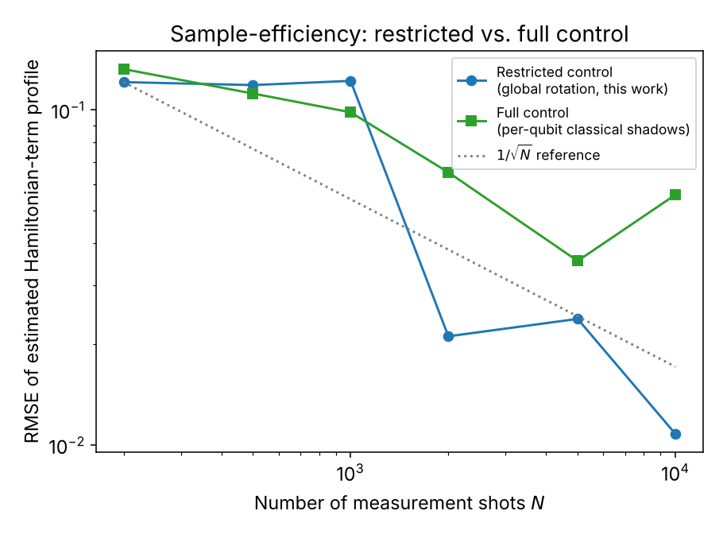

# Benchmarking Hamiltonian Realization via Restricted-Control Randomized Measurements


A small numerical study asking: **if a quantum device's actual Hamiltonian drifts from its intended design due to calibration error, can we detect that drift using only *restricted*, hardware-realistic randomized measurements — a single rotation applied identically to every qubit, rather than full per-qubit control?**

This repository implements and validates a numerically-constructed classical-shadow / kernel estimator for the restricted-control measurement scheme introduced in [Van Kirk, Cotler, Huang & Lukin (2022)](https://arxiv.org/abs/2212.06084), and uses it to probe Hamiltonian miscalibration on a 4-qubit Heisenberg spin chain.

---

## Table of Contents

- [Motivation](#motivation)
- [Key Idea](#key-idea)
- [Results](#results)
- [Repository Structure](#repository-structure)
- [Getting Started](#getting-started)
- [Methodology Summary](#methodology-summary)
- [Documentation](#documentation)
- [Honest Limitations](#honest-limitations)
- [References](#references)
- [Author](#author)
- [License](#license)

---

## Motivation

As theoretical Hamiltonian models are increasingly realized on quantum hardware, a central open question is whether a device actually implements its intended Hamiltonian H₀, or whether calibration drift, cross-talk, and control imperfections cause it to realize a different, nearby Hamiltonian H'. **Hamiltonian learning** is the set of techniques for inferring H' from measurement data rather than trusting the design specification. **Randomized benchmarking** contributes the measurement philosophy: scalable, SPAM-robust estimation built from randomized circuits instead of full tomography.

This project sits at the intersection of the two — using a restricted-control randomized-measurement scheme (physically realistic for platforms like Rydberg-atom arrays, where only a single shared control field addresses every qubit) to directly attack the Hamiltonian-verification question.

## Key Idea

1. Define an **intended** Hamiltonian H₀ (a 4-qubit Heisenberg-type spin chain).
2. Construct a **miscalibrated** "realized" Hamiltonian H_ε by perturbing each coupling by a controlled random amount scaled by ε.
3. Restrict measurement to **one randomly-rotated unitary applied identically to every qubit**, followed by computational-basis measurement — no per-qubit addressing allowed.
4. Numerically construct the measurement-response superoperator *M* (via Monte Carlo over Haar-random SU(2)) and its pseudo-inverse, to build an unbiased **kernel estimator** for each local Hamiltonian term — directly generalizing the classical-shadow machinery of Van Kirk et al. to this restricted ensemble.
5. Ask: using only this restricted measurement data, can we detect that H_ε ≠ H₀, and how does that detectability scale with noise strength ε and shot count N?

## Results

| Visible space under global control | Detecting miscalibration vs. ε | Sample efficiency vs. shot count |
|---|---|---|
|  |  |  |

**Headline findings:**

- Under global-rotation-only control, **104 of 256** possible 4-qubit Pauli-operator directions are structurally visible to this measurement scheme — restricted control still leaves a large, usable observable space.
- Hamiltonian miscalibration becomes **clearly detectable** once the true deviation exceeds the shot-noise floor (around ε ≳ 0.2 at an 8,000-shot budget for this system size).
- For this SU(2)-symmetric Heisenberg Hamiltonian, the restricted-control estimator is **at least as sample-efficient** as the standard unrestricted per-qubit classical-shadow baseline — a measurement ensemble that shares the observable's own symmetry can out-perform a generic one.

## Repository Structure

```
.
├── core.py            # Hamiltonian construction, Pauli-string basis, exact diagonalization
├── shadows.py          # Restricted-control measurement model + numerically-constructed
│                        # classical-shadow/kernel estimator, plus a full-control baseline
├── validate.py          # Sanity check: estimator vs. exact ground-truth expectation values
├── experiment.py         # Main experiment — noise-detection and sample-efficiency sweeps
├── plot.py             # Generates all figures from results.json
├── results.json          # Saved numerical results from experiment.py
├── fig1_detection_vs_eps.png
├── fig2_rmse_vs_shots.png
├── fig3_visible_space.png
├── Hamiltonian_Learning_MiniProject_Report.pdf     # Full write-up (methodology, results, discussion)
├── Hamiltonian_Learning_Full_Explainer.pdf        # Concept-by-concept explainer + code walkthrough
├── LICENSE
└── README.md
```

## Getting Started

**Requirements:** Python 3.9+, with `numpy`, `scipy`, and `matplotlib`.

```bash
pip install numpy scipy matplotlib
```

**Run the pipeline in order:**

```bash
# 1. Sanity-check the restricted-control estimator against exact ground truth
python validate.py

# 2. Run the main noise-detection and sample-efficiency experiment
python experiment.py

# 3. Generate the figures
python plot.py
```

All computation is classical exact-diagonalization on a 4-qubit (16-dimensional) Hilbert space — no quantum hardware or SDK required. The full pipeline runs in well under two minutes on a laptop.

## Methodology Summary

- **Model:** 4-qubit open-boundary Heisenberg chain, H₀ = Σᵢ J(XᵢXᵢ₊₁ + YᵢYᵢ₊₁ + Δ ZᵢZᵢ₊₁) + h Σᵢ Zᵢ.
- **Noise model:** per-bond coupling perturbation Jᵢ → Jᵢ(1 + ε·δᵢ), fixed random pattern δᵢ, single knob ε.
- **Probe state:** exact ground state of H_ε (standing in for what a miscalibrated device produces).
- **Measurement:** identical Haar-random single-qubit rotation applied to every qubit, then computational-basis measurement (the restricted-control ensemble of Van Kirk et al.).
- **Estimator:** the measurement-response superoperator *M* is estimated via Monte Carlo (6,000 samples) in the full 256-dimensional 4-qubit Pauli-string basis; target Hamiltonian terms are estimated via pseudo-inverse dual operators M⁻¹(O), validated against exact values before use.
- **Baseline:** standard unrestricted per-qubit classical shadows (Huang, Kueng & Preskill 2020), with closed-form dual channel 3U†|b⟩⟨b|U − I.

Full derivations, every concept explained from first principles, and a rehearsal Q&A are in the PDFs below.

## Documentation

- 📄 **[Hamiltonian_Learning_MiniProject_Report.pdf](Hamiltonian_Learning_MiniProject_Report.pdf)** — the formal write-up: motivation, methodology, results, discussion, limitations, and proposed next steps.
- 📘 **[Hamiltonian_Learning_Full_Explainer.pdf](Hamiltonian_Learning_Full_Explainer.pdf)** — a from-scratch explainer covering every concept used (Hamiltonian learning, randomized benchmarking, classical shadows, the visible/invisible space formalism, Haar randomness, the Born rule, the pseudo-inverse construction), a full code walkthrough, and a rehearsal Q&A.

## Honest Limitations

- System size is small (n = 4 qubits) for same-day tractability; scaling behavior with n is untested.
- The measurement-response map *M* is estimated via Monte Carlo rather than derived in closed form via representation theory (Schur-Weyl duality), as the source paper does for symmetric observables.
- A single fixed random noise pattern was used, scaled by ε; results have not been averaged over multiple independent noise realizations.
- The probe state is the exact ground state of H_ε, not a simulated noisy state-preparation protocol (e.g. adiabatic or variational).
- The favorable sample-efficiency result is specific to this SU(2)-symmetric Hamiltonian and may not generalize to Hamiltonians without this symmetry.

See the full report for proposed next steps, including extending this to non-Hermitian / PT-symmetric Hamiltonians near an exceptional point.

## References

1. R. Van Kirk, J. Cotler, H.-Y. Huang, M. D. Lukin, "Hardware-Efficient Learning of Quantum Many-Body States," [arXiv:2212.06084](https://arxiv.org/abs/2212.06084) (2022).
2. N. Wiebe, C. Granade, C. Ferrie, D. G. Cory, "Hamiltonian Learning and Certification Using Quantum Resources," *Phys. Rev. Lett.* **112**, 190501 (2014).
3. E. Bairey, I. Arad, N. H. Lindner, "Learning a Local Hamiltonian from Local Measurements," *Phys. Rev. Lett.* **122**, 020504 (2019).
4. H.-Y. Huang, Y. Tong, D. Fang, Y. Su, "Learning Many-Body Hamiltonians with Heisenberg-Limited Scaling," *Phys. Rev. Lett.* **130**, 200403 (2023).
5. H.-Y. Huang, R. Kueng, J. Preskill, "Predicting Many Properties of a Quantum System from Very Few Measurements," *Nature Physics* **16**, 1050–1057 (2020).

## Author

**Sai Swapnil Kumar Mishra**
Final-Year Engineering Physics Undergraduate, IIT (ISM) Dhanbad
Final-year research project supervised by **Prof. Sudipto Singha Roy**, Department of Physics, IIT (ISM) Dhanbad

## License

This project is licensed under the [MIT License](LICENSE).
